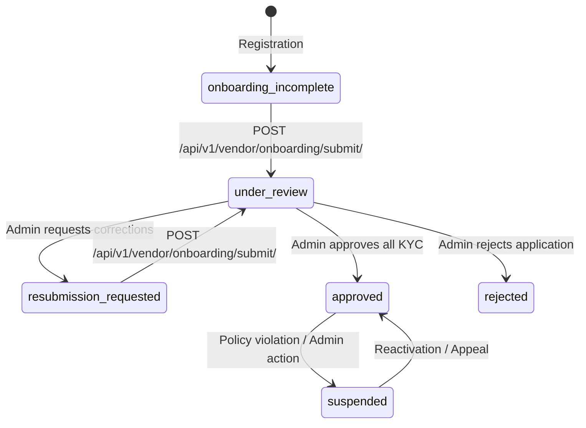

# ChillyFlakes Marketplace — Vendor API Contract

This document provides the API specifications for the Node.js backend team for the Vendor Authentication, Registration, and Dual-Channel OTP Verification flow.

> **CRITICAL SECURITY REQUIREMENT FOR BACKEND:**
> Frontend validation is implemented for user experience and instant feedback only. The backend **MUST enforce all validation rules, uniqueness constraints, sanitization, rate limits, and verification checks independently**. Never trust client-provided payloads.

---

## Error Format

All error responses across the API follow a standardized JSON envelope:

```json
{
  "code": "validation_error",
  "message": "Please resolve the highlighted errors before submitting.",
  "fieldErrors": {
    "title": ["This field is required."],
    "colors.0.images": ["Color 'Indigo Blue' must have at least 1 photo."],
    "attributes.fabric": ["Fabric / Material is required for Clothes & Fashion."]
  },
  "retry_after_seconds": 900
}
```

- **`code`** (`string`, required): Machine-readable identifier for the error category or condition (e.g., `"validation_error"`, `"already_registered"`, `"invalid_otp"`, `"too_many_attempts"`).
- **`message`** (`string`, required): Human-readable error description or summary suitable for user feedback.
- **`fieldErrors`** (`object`, optional): An object mapping field identifiers to arrays of error strings. Dotted paths are used for nested fields or list indices (e.g., `"colors"`, `"colors.0.images"`, `"attributes.fabric"`). The value for every field key is strictly an array of strings (e.g. `"title": ["This field is required"]`).
- **`retry_after_seconds`** (`integer`, optional): Integer seconds indicating remaining wait time when rate-limited or locked (e.g., on HTTP `429 Too Many Requests`).

---

## CSRF Protection (`GET /api/v1/csrf/`)

All state-changing endpoints (`POST`, `PUT`, `PATCH`, `DELETE`) require CSRF verification (token returned in the `X-CSRFToken` response header and sent back in the `X-CSRFToken` request header).

- **Method:** `GET`
- **Path:** `/api/v1/csrf/`
- **Authentication:** Public
- **Response Headers:** `X-CSRFToken: <csrf-token>`
- **Response Body (`200 OK`):**
```json
{
  "detail": "ok"
}
```

> **CSRF HANDLING REQUIREMENT:**
> `GET /api/v1/csrf/` returns `{ "detail": "ok" }` and puts the token in the `X-CSRFToken` **RESPONSE HEADER**. The CSRF cookie is `HttpOnly`, so the frontend must read the token from that header and send it back in the `X-CSRFToken` request header on every `POST`, `PUT`, `PATCH`, and `DELETE`.

---

## 1. Auth: Register (`POST /api/v1/vendor/auth/register/`)

Registers a new vendor/artisan account on ChillyFlakes in `pending_verification` status, sets a signed `httpOnly` pending session cookie, and dispatches separate 6-digit OTP codes to the vendor's email and mobile number.

### 1.1 Endpoint Overview
- **Method:** `POST`
- **Path:** `/api/v1/vendor/auth/register/`
- **Authentication:** Public (Rate-limited)
- **Content-Type:** `application/json`
- **Accept:** `application/json`
- **Credentials:** Supports `withCredentials: true` (Sets signed `pending_registration` cookie)

### 1.2 Request Body

| Field Name | Type | Required | Description & Validation Rules |
|---|---|:---:|---|
| `full_name` | `string` | **Yes** | Full legal or display name of the seller. Min 2 characters, max 100 characters. Trim whitespace. |
| `email` | `string` | **Yes** | Valid email address. Max 255 characters. Unique check against approved/active vendors. |
| `mobile` | `string` | **Yes** | 10-digit Indian mobile number starting with 6, 7, 8, or 9 (e.g., `"9876543210"`). Unique check against approved/active vendors. |
| `business_name` | `string` | **Yes** | Name of the shop, studio, or enterprise. Min 2 characters, max 100 characters. |
| `categories` | `string[]` | **Yes** | Array of category IDs strictly from: `["natural-products", "handmade-products", "jewelry", "clothes-fashion", "home-living", "retail-products", "services", "books"]`. |
| `wholesale_enabled` | `boolean` | **Yes** | Whether the seller wants to sell in bulk / wholesale. Defaults to `false`. |
| `state` | `string` | **Yes** | State or Union Territory code/name (e.g., `"KL"`, `"TN"`). Must match official Indian States / UTs. |
| `city` | `string` | **Yes** | City / Town / District. Min 2 characters, max 100 characters. |
| `password` | `string` | **Yes** | Plaintext password (sent over HTTPS, hashed using Argon2/PBKDF2). Min 8 chars, 1 uppercase, 1 lowercase, 1 number, 1 symbol. |
| `agree_terms` | `boolean` | **Yes** | Must be `true`. Indicates acceptance of Seller Terms & Conditions and Privacy Policy. |

#### Example Request Payload:
```json
{
  "full_name": "Aiswarya Lakshmi",
  "email": "aiswarya.crafts@example.com",
  "mobile": "9876543210",
  "business_name": "Lakshmi Handmade Terracotta",
  "categories": ["natural-products", "handmade-products"],
  "wholesale_enabled": true,
  "state": "KL",
  "city": "Thrissur",
  "password": "SecurePassword#2026",
  "agree_terms": true
}
```

### 1.3 Success Response
- **Status Code:** `201 Created`
- **Set-Cookie Header:** `pending_reg=<signed_token>; HttpOnly; Secure; SameSite=Lax; Path=/api/v1/vendor/auth/`
- **Payload:**
```json
{
  "message": "Account created. OTP sent to your email and mobile.",
  "masked_email": "ai***@example.com",
  "masked_mobile": "+91 98XXXXXX10"
}
```

### 1.4 Error Responses
- **Email Already Registered (Status `400 Bad Request` or `409 Conflict`):**
```json
{
  "code": "already_registered",
  "message": "This email is already registered",
  "fieldErrors": {
    "email": ["This email is already registered. Login instead"]
  }
}
```
- **Mobile Number Already Registered:**
```json
{
  "code": "already_registered",
  "message": "This mobile number is already registered",
  "fieldErrors": {
    "mobile": ["This mobile number is already registered. Login instead"]
  }
}
```

---

## 2. Auth: Check Availability (`POST /api/v1/vendor/auth/check-availability/`)

Provides non-blocking, debounced field-level availability checks for email or mobile while the vendor fills out the registration form.

### 2.1 Endpoint Overview
- **Method:** `POST`
- **Path:** `/api/v1/vendor/auth/check-availability/`
- **Authentication:** Public (Strict rate limiting to prevent enumeration)
- **Content-Type:** `application/json`

### 2.2 Request Body
```json
{
  "channel": "email",
  "value": "artisan@example.com"
}
```
*(Or `"channel": "mobile"`, `"value": "9876543210"`)*

### 2.3 Response
- **Status Code:** `200 OK`
```json
{
  "available": true
}
```
*(If already registered: `{ "available": false }`)*

---

## 3. Auth: Verification Status (`GET /api/v1/vendor/auth/verification-status/`)

Reads the verification state of the pending vendor identified by the signed `httpOnly` cookie. Enables page refreshes on `/vendor/verify-otp` without losing progress.

### 3.1 Endpoint Overview
- **Method:** `GET`
- **Path:** `/api/v1/vendor/auth/verification-status/`
- **Authentication:** Authenticated via `pending_reg` cookie (`withCredentials: true`)

### 3.2 Success Response (`200 OK`)
```json
{
  "mobile": {
    "masked": "+91 98XXXXXX21",
    "verified": false,
    "resend_available_in": 30
  },
  "email": {
    "masked": "ab***@gmail.com",
    "verified": true,
    "resend_available_in": 0
  },
  "all_verified": false
}
```

### 3.3 No Pending Registration (`401 Unauthorized`)
```json
{
  "code": "no_pending_registration",
  "message": "No pending registration found."
}
```
*(Client automatically redirects to `/vendor/register`)*

---

## 4. Auth: Verify OTP (`POST /api/v1/vendor/auth/verify-otp/`)

Verifies the 6-digit code for a specific channel (`mobile` or `email`). Verifying one channel never resets or affects the other.

### 4.1 Endpoint Overview
- **Method:** `POST`
- **Path:** `/api/v1/vendor/auth/verify-otp/`
- **Authentication:** Authenticated via `pending_reg` cookie (`withCredentials: true`)

### 4.2 Request Body
```json
{
  "channel": "mobile",
  "otp": "123456"
}
```

### 4.3 Success Response (`200 OK`)
```json
{
  "channel": "mobile",
  "verified": true,
  "all_verified": false
}
```
*(When both channels are verified, `all_verified` is `true`, the user account is promoted to `onboarding_incomplete`, and session cookies are issued).*

### 4.4 Error Responses
- **Invalid OTP (`400 Bad Request`):**
```json
{
  "code": "invalid_otp",
  "message": "Invalid OTP code. Please check and try again."
}
```
- **Expired OTP (`400 Bad Request`):**
```json
{
  "code": "otp_expired",
  "message": "This OTP has expired. Please request a new code."
}
```
- **Too Many Failed Attempts (`429 Too Many Requests`):**
```json
{
  "code": "too_many_attempts",
  "message": "Too many failed attempts. Channel locked for 15 minutes.",
  "retry_after_seconds": 900
}
```

---

## 5. Auth: Resend OTP (`POST /api/v1/vendor/auth/resend-otp/`)

Dispatches a fresh 6-digit OTP to the requested channel (`mobile` or `email`) and resets the 30-second cooldown timer.

### 5.1 Endpoint Overview
- **Method:** `POST`
- **Path:** `/api/v1/vendor/auth/resend-otp/`
- **Authentication:** Authenticated via `pending_reg` cookie (`withCredentials: true`)

### 5.2 Request Body
```json
{
  "channel": "mobile"
}
```

### 5.3 Success Response (`200 OK`)
```json
{
  "resend_available_in": 30
}
```

### 5.4 Error Responses
- **Resend Too Soon (`429 Too Many Requests`):**
```json
{
  "code": "resend_too_soon",
  "message": "Please wait 24 seconds before requesting another code.",
  "retry_after_seconds": 24
}
```
- **Exceeded Hourly Limit (`429 Too Many Requests`):**
```json
{
  "code": "too_many_resends",
  "message": "Maximum OTP resend limit reached for this hour.",
  "retry_after_seconds": 3600
}
```

---

## 6. Auth: Login, Session & Profile

### 6.1 Vendor Login (`POST /api/v1/vendor/auth/login/`)

Authenticates an existing vendor using identifier (email or 10-digit mobile) and password.

- **Method:** `POST`
- **Path:** `/api/v1/vendor/auth/login/`
- **Authentication:** Public (Rate-limited)
- **Content-Type:** `application/json`

#### Request Body
```json
{
  "identifier": "aiswarya.crafts@example.com",
  "password": "SecurePassword#2026"
}
```
*(Accepts either registered email address or 10-digit Indian mobile number)*

#### Successful Login Response (`200 OK`)
Returns HTTP 200 with the vendor user profile object:
```json
{
  "id": "a0eebc99-9c0b-4ef8-bb6d-6bb9bd380a11",
  "full_name": "Aiswarya Lakshmi",
  "email": "aiswarya.crafts@example.com",
  "mobile_masked": "+91 98XXXXXX10",
  "vendor_status": "approved",
  "store_name": "Lakshmi Handmade Terracotta"
}
```
*(IDs are UUID strings, not "v_101" style).*

#### Pending Verification Login Response (`200 OK`)
If the credentials are valid but the vendor's status is `pending_verification`, the server responds with HTTP 200, keeps its existing shape, and creates no session:
```json
{
  "message": "Account pending verification",
  "vendor_status": "pending_verification",
  "user": {
    "id": "a0eebc99-9c0b-4ef8-bb6d-6bb9bd380a11",
    "full_name": "Priya Nair",
    "email": "pending@test.com",
    "mobile_masked": "+91 98XXXXXX11",
    "vendor_status": "pending_verification"
  }
}
```
Client redirects the vendor directly to `/vendor/verify-otp`. The pending-verification login response keeps its existing shape and creates no session.

---

### 6.2 Current Vendor (`GET /api/v1/vendor/auth/me/`)

Retrieves the current authenticated vendor profile.

- **Method:** `GET`
- **Path:** `/api/v1/vendor/auth/me/`
- **Authentication:** Authenticated Vendor Session / Bearer Token

#### Success Response (`200 OK`)
Returns the same flat object as successful vendor login:
```json
{
  "id": "a0eebc99-9c0b-4ef8-bb6d-6bb9bd380a11",
  "full_name": "Aiswarya Lakshmi",
  "email": "aiswarya.crafts@example.com",
  "mobile_masked": "+91 98XXXXXX10",
  "vendor_status": "approved",
  "store_name": "Lakshmi Handmade Terracotta"
}
```
*(IDs are UUID strings, not "v_101" style).*

#### Error Responses
- **Not Logged In (`401 Unauthorized`):**
```json
{
  "code": "not_authenticated",
  "message": "Authentication credentials were not provided."
}
```
- **Non-Vendor Roles (`403 Forbidden`):**
```json
{
  "code": "permission_denied",
  "message": "You do not have permission to access vendor resources."
}
```

---

### 6.3 Vendor Logout (`POST /api/v1/vendor/auth/logout/`)

Terminates the vendor session.

- **Method:** `POST`
- **Path:** `/api/v1/vendor/auth/logout/`
- **Authentication:** Authenticated Vendor Session
- **Success Response:** `204 No Content` (with no response body).

---

## 7. Auth: Password Reset Flow

A secure 3-step password reset workflow for sellers with zero email/mobile account enumeration.

### 7.1 Request Reset Code (`POST /api/v1/vendor/auth/password-reset/request/`)
- **Method:** `POST`
- **Path:** `/api/v1/vendor/auth/password-reset/request/`
- **Authentication:** Public (Rate-limited: 5 requests / IP / hour)
- **Anti-Enumeration:** The endpoint **must always return 200 OK** with a masked identifier representation even if the email or mobile does not exist in the system.
- **Request Body:**
```json
{
  "identifier": "priya@example.com"
}
```
- **Success Response (`200 OK`):**
- **Set-Cookie Header:** `pwd_reset=<signed_token>; HttpOnly; Secure; SameSite=Lax; Path=/api/v1/vendor/auth/password-reset/`
```json
{
  "message": "If an account exists, a verification code has been dispatched.",
  "masked": "pr***@example.com",
  "resend_available_in": 30
}
```

### 7.2 Verify Reset OTP (`POST /api/v1/vendor/auth/password-reset/verify/`)
- **Method:** `POST`
- **Path:** `/api/v1/vendor/auth/password-reset/verify/`
- **Authentication:** Session cookie (`pwd_reset`)
- **Request Body:**
```json
{
  "otp": "123456"
}
```
- **Success Response (`200 OK`):**
```json
{
  "verified": true
}
```
- **Error Responses:**
  - `400 Bad Request` with `invalid_otp` or `otp_expired`
  - `400 Bad Request` with `reset_session_expired`
  - `429 Too Many Requests` with `too_many_attempts` (locked for 15 minutes)

### 7.3 Resend Reset OTP (`POST /api/v1/vendor/auth/password-reset/resend/`)
- **Method:** `POST`
- **Path:** `/api/v1/vendor/auth/password-reset/resend/`
- **Authentication:** Session cookie (`pwd_reset`)
- **Success Response (`200 OK`):**
```json
{
  "resend_available_in": 30
}
```
- **Error Responses:**
  - `429 Too Many Requests` with `resend_too_soon` (provides `retry_after_seconds`)
  - `429 Too Many Requests` with `too_many_resends` (max 3 resends / hour)

### 7.4 Confirm New Password (`POST /api/v1/vendor/auth/password-reset/confirm/`)
- **Method:** `POST`
- **Path:** `/api/v1/vendor/auth/password-reset/confirm/`
- **Authentication:** Session cookie (`pwd_reset`)
- **Request Body:**
```json
{
  "new_password": "NewSecurePassword#2026",
  "confirm_password": "NewSecurePassword#2026"
}
```
- **Validation:**
  - Must meet password complexity rules (8+ chars, upper, lower, number, symbol).
  - Must differ from the previous password; returns `password_reused` if matching old hash.
- **Success Response (`200 OK`):**
- **Set-Cookie Header:** Clears `pwd_reset` cookie (`Max-Age=0`). Does **not** auto-login the vendor.
```json
{
  "message": "Password updated successfully. Please log in."
}
```

### 7.5 Check Reset Session Status (`GET /api/v1/vendor/auth/password-reset/status/`)
- **Method:** `GET`
- **Path:** `/api/v1/vendor/auth/password-reset/status/`
- **Authentication:** Session cookie (`pwd_reset`)
- **Success Response (`200 OK`):**
```json
{
  "step": "verify" // or "new_password" | "none"
}
```

---

## 8. Backend Architecture & Security Rules

1. **Dual OTP Generation & Cryptographic Storage:**
   - OTPs must be 6 numeric digits generated using a cryptographically secure pseudo-random number generator (`crypto.randomInt(100000, 1000000)`).
   - OTPs must **never be stored in plaintext** in the database or cache. Stored using HMAC-SHA256 with a server secret (`OTP_PEPPER`) and constant-time comparison.
   - OTP validity is strictly **10 minutes**.
2. **Attempt Limits & Channel Lockout:**
   - Maximum 5 failed attempts per channel or reset session.
   - On the 5th incorrect attempt, the session/channel is locked for **15 minutes** (`900 seconds`). An attempt on one channel must never lock the other channel.
3. **Resend Throttling:**
   - 30-second minimum cooldown gap between consecutive resends on the same channel or reset session.
   - Maximum 3 resends per hour per channel. The 4th attempt returns `429 too_many_resends`.
4. **Timing Attack Protection:**
   - Always verify OTP hashes using constant-time comparison (`crypto.timingSafeEqual`).
5. **Anti-Enumeration & Privacy:**
   - Public endpoints like password reset request must never reveal whether an account exists.
6. **Pending Account Lifecycle:**
   - When a user registers, create the record in status `pending_verification`.
   - If a new registration is submitted with an unverified email or mobile matching an existing unverified pending record, the old pending record and OTPs are replaced.
   - Unverified pending accounts older than 24 hours are removed by a scheduled cleanup job (cron or a scheduled script); no job-queue requirement for now.
7. **Identification via Cookie (Zero Leaks):**
   - The pending registration and password reset sessions are identified solely through signed, `httpOnly`, `Secure`, and `SameSite=Lax` cookies.
   - The frontend never receives, stores, or sends sensitive internal user IDs or raw tokens in URLs or localStorage.
8. **Production Logging Safety:**
   - Plaintext OTPs, full phone numbers, and full email addresses must never appear in production logs or telemetry. Mask all identifiers (`+91 98XXXXXX21`, `ab***@gmail.com`).
9. **Notification Service Interfaces:**
   - Notifications are sent right after the database transaction commits through SMS and email service interfaces (console in development). Background sending (a worker queue) is required before launch.

---

## 9. Vendor Dashboard (`/api/v1/vendor/dashboard/`)

The seller dashboard provides real-time analytics, inventory monitoring, conscious buyer order management, and store alerts for approved artisans.

### 9.1 General Rules & Permissions
- **Permission Requirement:** Authenticated vendor session and vendor status must strictly be `approved`. Vendors in other statuses (`pending_verification`, `onboarding_incomplete`, `under_review`, `rejected`, `suspended`) are denied access with `403 Forbidden`.
- **Data Scoping:** Every endpoint strictly scopes data to the authenticated vendor (resolved from the session). A vendor can never view or calculate metrics from another store.
- **Monetary Unit Representation:** All monetary values are calculated server-side and transmitted strictly as **integer paise** (e.g., `12450000` paise = ₹1,24,500.00). Frontend formats into INR using Indian digit grouping (`en-IN`).
- **Pagination Standard:** List endpoints that can grow use page-number pagination with the envelope `{ count, next, previous, results }`.

---

### 9.2 Dashboard Summary Metrics (`GET /api/v1/vendor/dashboard/summary/`)
- **Method:** `GET`
- **Path:** `/api/v1/vendor/dashboard/summary/`
- **Authentication:** Session cookie / Bearer token
- **Success Response (`200 OK`):**
```json
{
  "total_sales_paise": 12450000,
  "orders_today": 8,
  "pending_orders": 3,
  "low_stock_count": 4,
  "available_balance_paise": 8720000,
  "pending_payout_paise": 3730000,
  "changes": {
    "total_sales_pct": 14.2,
    "orders_today_pct": 25.0,
    "pending_orders_diff": -1,
    "available_balance_pct": 8.5
  }
}
```

---

### 9.3 Sales Revenue Chart (`GET /api/v1/vendor/dashboard/sales-chart/`)
- **Method:** `GET`
- **Path:** `/api/v1/vendor/dashboard/sales-chart/?range=7|30|90`
- **Query Parameters:**
  - `range` (string, optional, defaults to `"30"`): `"7"`, `"30"`, or `"90"`.
- **Success Response (`200 OK`):**
```json
{
  "range": "30",
  "points": [
    {
      "date": "2026-09-19",
      "sales_paise": 234000,
      "orders": 3
    },
    {
      "date": "2026-09-20",
      "sales_paise": 412000,
      "orders": 6
    }
  ]
}
```

---

### 9.4 Recent Orders (`GET /api/v1/vendor/dashboard/recent-orders/`)
- **Method:** `GET`
- **Path:** `/api/v1/vendor/dashboard/recent-orders/`
- **Query Parameters:**
  - `page` (integer, default `1`)
  - `page_size` (integer, default `5`)
- **Success Response (`200 OK`):**
```json
{
  "count": 10,
  "next": "/api/v1/vendor/dashboard/recent-orders/?page=2&page_size=5",
  "previous": null,
  "results": [
    {
      "id": "ord_1",
      "order_number": "ORD-8492",
      "customer_first_name": "Priya",
      "amount_paise": 320000,
      "status": "processing",
      "date": "2026-10-18T14:20:00Z"
    }
  ]
}
```

---

### 9.5 Low Stock Inventory (`GET /api/v1/vendor/dashboard/low-stock/`)
- **Method:** `GET`
- **Path:** `/api/v1/vendor/dashboard/low-stock/`
- **Query Parameters:**
  - `page` (integer, default `1`)
  - `page_size` (integer, default `5`)
- **Success Response (`200 OK`):**
```json
{
  "count": 4,
  "next": null,
  "previous": null,
  "results": [
    {
      "id": "item_1",
      "product_name": "Natural Clay Water Pot",
      "stock_left": 2,
      "threshold": 5,
      "category": "Handmade Pottery"
    }
  ]
}
```

---

### 9.6 Recent Customer Reviews (`GET /api/v1/vendor/dashboard/recent-reviews/`)
- **Method:** `GET`
- **Path:** `/api/v1/vendor/dashboard/recent-reviews/`
- **Query Parameters:**
  - `page` (integer, default `1`)
  - `page_size` (integer, default `5`)
- **Success Response (`200 OK`):**
```json
{
  "count": 5,
  "next": null,
  "previous": null,
  "results": [
    {
      "id": "rev_1",
      "customer_name": "Nandini S.",
      "rating": 5,
      "comment": "Beautiful craftsmanship, the terracotta jug keeps water cool naturally!",
      "product_name": "Handmade Terracotta Jug",
      "date": "2026-10-17T10:00:00Z"
    }
  ]
}
```

---

### 9.7 Store Alerts (`GET /api/v1/vendor/dashboard/alerts/`)
- **Method:** `GET`
- **Path:** `/api/v1/vendor/dashboard/alerts/`
- **Success Response (`200 OK`):**
```json
[
  {
    "id": "alt_1",
    "title": "Payout Processed",
    "message": "Your weekly payout of ₹37,300 has been initiated to your registered bank account.",
    "type": "success",
    "created_at": "2026-10-18T10:00:00Z"
  }
]
```

---

## 10. Vendor Products: List and Actions

Endpoints for managing the vendor's physical product catalogue, inventory levels, lifecycle statuses, and review submissions.

> **Note on Product Approvals:** Approval and rejection of submitted products (`pending_review`) is performed exclusively by platform super admins on the backend administration console; there are no vendor-facing API endpoints for direct approval or rejection.

### 10.1 Product Statuses & State Transitions

| Status | Description | Allowed Vendor Actions |
|---|---|---|
| `draft` | Product saved by seller, not yet submitted | Edit, Duplicate, Delete, Submit for Review |
| `pending_review` | Submitted by seller, locked awaiting admin review | Withdraw (moves back to `draft`) |
| `approved` | Approved by super admin and live on marketplace | Unpublish, Archive, Duplicate |
| `rejected` | Rejected by admin with explanatory reason | Edit / Fix & Resubmit, Duplicate, Archive |
| `unpublished` | Hidden from marketplace by seller | Republish (restores live without new review), Edit, Archive, Duplicate |
| `archived` | Decommissioned product listing | Duplicate |

---

### 10.2 List Products (`GET /api/v1/vendor/products/`)

Returns a paginated list of vendor products filtered by status, category, stock level, or search query, along with status count aggregates.

- **Method:** `GET`
- **Path:** `/api/v1/vendor/products/`
- **Authentication:** Bearer JWT or Session Cookie (`vendor_status: approved`)
- **Query Parameters:**
  - `status` (string, optional): One of `all`, `draft`, `pending_review`, `approved`, `rejected`, `unpublished`, `archived`. Default `all`.
  - `category` (string, optional): Category ID. Strictly one of the 7 sellable product categories:
    - `natural-products`
    - `handmade-products`
    - `jewelry`
    - `clothes-fashion`
    - `home-living`
    - `retail-products`
    - `books`
    *(Note: `services` is managed separately under the Services module).*
  - `wholesale` (boolean, optional): `true` for wholesale-enabled, `false` for retail-only.
  - `low_stock` (boolean, optional): `true` to return products with stock ≤ 5.
  - `search` (string, optional): Case-insensitive match on product title or SKU.
  - `ordering` (string, optional): `updated_desc` (default), `updated_asc`, `price_asc`, `price_desc`, `stock_asc`, `stock_desc`.
  - `page` (integer, default `1`)
  - `page_size` (integer, default `10`)

#### Success Response (`200 OK`):
```json
{
  "count": 25,
  "next": "/api/v1/vendor/products/?page=2&page_size=10",
  "previous": null,
  "status_counts": {
    "all": 25,
    "draft": 3,
    "pending_review": 4,
    "approved": 11,
    "rejected": 2,
    "unpublished": 3,
    "archived": 2
  },
  "results": [
    {
      "id": "prod_1",
      "title": "Handcrafted Terracotta Clay Water Carafe",
      "sku": "TER-CAR-01",
      "main_image_url": "https://images.unsplash.com/photo-1513519245088-0e12902e5a38?auto=format&fit=crop&w=400&q=80",
      "category": {
        "id": "home-living",
        "name": "Home & Living"
      },
      "price_paise": 85000,
      "total_stock": 18,
      "colors": [
        { "name": "Terracotta Red", "hex": "#C85A32" },
        { "name": "Earthy Brown", "hex": "#6E473B" }
      ],
      "status": "approved",
      "wholesale_enabled": true,
      "created_at": "2026-09-10T10:00:00Z",
      "updated_at": "2026-10-18T16:30:00Z"
    }
  ]
}
```

---

### 10.3 Duplicate Product (`POST /api/v1/vendor/products/{id}/duplicate/`)

Creates a copy of an existing product as a new `draft` listing with a unique SKU (`-COPY`).

- **Method:** `POST`
- **Path:** `/api/v1/vendor/products/{id}/duplicate/`
- **Success Response (`201 Created`):** Returns the newly created `VendorProduct` in `draft` status.

---

### 10.4 Withdraw Product from Review (`POST /api/v1/vendor/products/{id}/withdraw/`)

Withdraws a submitted product in `pending_review` status back to `draft` so the vendor can edit it.

- **Method:** `POST`
- **Path:** `/api/v1/vendor/products/{id}/withdraw/`
- **Success Response (`200 OK`):** Returns updated product with status `draft`.
- **Error Response (`400 Bad Request`):** `{ "code": "invalid_status_transition", "message": "Only products under review can be withdrawn." }`

---

### 10.5 Unpublish Product (`POST /api/v1/vendor/products/{id}/unpublish/`)

Hides a live approved product from the storefront.

- **Method:** `POST`
- **Path:** `/api/v1/vendor/products/{id}/unpublish/`
- **Success Response (`200 OK`):** Returns updated product with status `unpublished`.
- **Error Response (`400 Bad Request`):** `{ "code": "invalid_status_transition", "message": "Only live approved products can be unpublished." }`

---

### 10.6 Republish Product (`POST /api/v1/vendor/products/{id}/republish/`)

Restores an unpublished product back to `approved` (live) without triggering a re-review if core attributes haven't changed.

- **Method:** `POST`
- **Path:** `/api/v1/vendor/products/{id}/republish/`
- **Success Response (`200 OK`):** Returns updated product with status `approved`.
- **Error Response (`400 Bad Request`):** `{ "code": "invalid_status_transition", "message": "Only unpublished products can be republished." }`

---

### 10.7 Archive Product (`POST /api/v1/vendor/products/{id}/archive/`)

Archives a product listing permanently removing it from active sale.

- **Method:** `POST`
- **Path:** `/api/v1/vendor/products/{id}/archive/`
- **Success Response (`200 OK`):** Returns updated product with status `archived`.

---

### 10.8 Delete Draft Product (`DELETE /api/v1/vendor/products/{id}/`)

Permanently deletes a product. **Enforced rule:** only products in `draft` status may be deleted.

- **Method:** `DELETE`
- **Path:** `/api/v1/vendor/products/{id}/`
- **Success Response (`200 OK`):**
```json
{
  "success": true,
  "message": "Draft product deleted successfully."
}
```
- **Conflict Error (`409 Conflict`):**
```json
{
  "code": "not_deletable",
  "message": "Only draft products can be deleted. You can unpublish or archive live products instead."
}
```

---

## 11. Admin: Product Review

Dedicated backend super administration endpoints for managing the platform product moderation queue, verifying submissions against marketplace quality guidelines, and approving or rejecting artisan listings.

### 11.1 Admin Authentication

Admin sessions are managed via secure HTTP cookies or bearer sessions under `/api/v1/admin/auth/`. Admins cannot access vendor endpoints, and vendors cannot access admin review endpoints.

#### 11.1.1 Admin Login (`POST /api/v1/admin/auth/login/`)
- **Method:** `POST`
- **Path:** `/api/v1/admin/auth/login/`
- **Request Body:**
```json
{
  "email": "admin@test.com",
  "password": "••••••••"
}
```
- **Success Response (`200 OK`):**
```json
{
  "message": "Admin login successful",
  "user": {
    "id": "admin_1",
    "email": "admin@test.com",
    "name": "Platform Super Admin",
    "role": "admin"
  }
}
```
- **Error Response (`401 Unauthorized`):**
```json
{
  "code": "invalid_credentials",
  "message": "Invalid admin email or password."
}
```

#### 11.1.2 Admin Current User (`GET /api/v1/admin/auth/me/`)
- **Method:** `GET`
- **Path:** `/api/v1/admin/auth/me/`
- **Success Response (`200 OK`):** Returns the authenticated `AdminUser` object.
- **Error Response (`401 Unauthorized`):** `{ "code": "not_authenticated", "message": "Admin authentication required." }`

#### 11.1.3 Admin Logout (`POST /api/v1/admin/auth/logout/`)
- **Method:** `POST`
- **Path:** `/api/v1/admin/auth/logout/`
- **Success Response (`200 OK`):** `{ "message": "Logged out successfully" }`

---

### 11.2 List Review Products (`GET /api/v1/admin/products/`)

Returns a paginated list of catalog products for administrative moderation, with queue counters for quick triage.

- **Method:** `GET`
- **Path:** `/api/v1/admin/products/`
- **Query Parameters:**
  - `status` (string, optional): Filter by `pending_review` (default tab), `approved`, `rejected`, or `all`.
  - `category` (string, optional): Product category ID.
  - `seller` (string, optional): Seller UUID string (e.g. `"a0eebc99-9c0b-4ef8-bb6d-6bb9bd380a11"`).
  - `search` (string, optional): Keyword query matched against product title, SKU, or seller store name.
  - `ordering` (string, optional): `submitted_asc` (default, oldest first for FIFO SLA), `submitted_desc`, `price_asc`, `price_desc`, `updated_desc`.
  - `page` (integer, default `1`)
  - `page_size` (integer, default `10`)

#### Success Response (`200 OK`):
```json
{
  "count": 28,
  "next": "/api/v1/admin/products/?page=2&page_size=10",
  "previous": null,
  "results": [
    {
      "id": "prod_26",
      "title": "Handblock Floral Mulmul Anarkali Dress",
      "sku": "CLO-ANK-26",
      "main_image_url": "https://images.unsplash.com/...",
      "category": { "id": "clothes-fashion", "name": "Clothes & Fashion" },
      "price_paise": 285000,
      "total_stock": 45,
      "status": "pending_review",
      "wholesale_enabled": true,
      "seller": {
        "seller_id": "b1ffbc88-8b1b-4ef7-aa6d-5bb8bd270b22",
        "store_name": "Heritage Handlooms & Crafts"
      },
      "submitted_at": "2026-10-18T08:30:00Z",
      "updated_at": "2026-10-18T08:30:00Z"
    }
  ],
  "status_counts": {
    "all": 28,
    "pending_review": 7,
    "approved": 13,
    "rejected": 3
  }
}
```

---

### 11.3 Product Review Detail (`GET /api/v1/admin/products/{id}/`)

Retrieves the complete submission payload for admin inspection, including seller profile verification, multilingual localized titles and descriptions, color galleries with high-resolution imagery, optional product video preview, variant inventory matrix, and audit history log.

- **Method:** `GET`
- **Path:** `/api/v1/admin/products/{id}/`
- **Success Response (`200 OK`):**
```json
{
  "id": "prod_26",
  "title": "Handblock Floral Mulmul Anarkali Dress",
  "title_i18n": {
    "en": "Handblock Floral Mulmul Anarkali Dress",
    "hi": "हैंडब्लॉक फ्लोरल मलमल अनारकली ड्रेस",
    "ml": "ഹാൻഡ്ബ്ലോക്ക് ഫ്ലോറൽ മൽമൽ അനാർക്കലി ഡ്രസ്സ്"
  },
  "sku": "CLO-ANK-26",
  "main_image_url": "https://images.unsplash.com/...",
  "category": { "id": "clothes-fashion", "name": "Clothes & Fashion" },
  "price_paise": 285000,
  "mrp_paise": 350000,
  "gst_rate_percent": 5,
  "total_stock": 45,
  "status": "pending_review",
  "wholesale_enabled": true,
  "wholesale_tiers": [
    { "min_quantity": 10, "unit_price_paise": 242250 }
  ],
  "shipping_weight_grams": 480,
  "shipping_dimensions": { "length_cm": 32, "width_cm": 25, "height_cm": 4 },
  "attributes": {
    "Fabric": "100% Mulmul Pure Cotton",
    "Origin": "Sanganer, Rajasthan, India"
  },
  "tags": ["Anarkali", "Bagru Block Print", "Pure Mulmul"],
  "description_i18n": {
    "en": "Handcrafted with care by rural artisans using traditional eco-conscious methods..."
  },
  "color_galleries": [
    {
      "color_name": "Indigo Blue",
      "hex": "#1B3B6F",
      "images": ["https://images.unsplash.com/..."]
    }
  ],
  "video_url": null,
  "variants": [
    { "sku": "CLO-ANK-26-BLU-S", "color_name": "Indigo Blue", "size": "S", "stock": 5, "price_paise": 285000 }
  ],
  "seller": {
    "seller_id": "b1ffbc88-8b1b-4ef7-aa6d-5bb8bd270b22",
    "store_name": "Heritage Handlooms & Crafts",
    "seller_name": "Meenakshi Sundaram",
    "email": "meenakshi@heritagecrafts.in",
    "mobile_masked": "+91 98451 •••••",
    "seller_status": "approved"
  },
  "submitted_at": "2026-10-18T08:30:00Z",
  "created_at": "2026-10-17T14:00:00Z",
  "updated_at": "2026-10-18T08:30:00Z",
  "review_history": []
}
```

---

### 11.4 Approve Product (`POST /api/v1/admin/products/{id}/approve/`)

Approves a product listing, transitioning its status from `pending_review` to `approved` and making it live on the ChillyFlakes store. Also appends an entry to the immutable review audit log and dispatches a notification alert to the seller's dashboard.

- **Method:** `POST`
- **Path:** `/api/v1/admin/products/{id}/approve/`
- **Concurrency Guard:** The product MUST currently have `status === 'pending_review'`.
- **Success Response (`200 OK`):** Returns updated product object with `status: "approved"` and updated `review_history`.
- **Conflict Error (`409 Conflict`):**
```json
{
  "code": "not_pending",
  "message": "Product is not in pending review state."
}
```

---

### 11.5 Reject Product (`POST /api/v1/admin/products/{id}/reject/`)

Rejects a product listing, transitioning status from `pending_review` to `rejected`. Requires a standard reason code and an explanatory reason string (10 to 500 characters) to help the seller correct issues and resubmit. Appends to the review audit log and sends an alert to the seller's dashboard.

- **Method:** `POST`
- **Path:** `/api/v1/admin/products/{id}/reject/`
- **Request Body:**
```json
{
  "reason_code": "poor_image_quality",
  "reason": "Photographs lack a clean plain neutral background and lighting causes heavy glare on the craftsmanship details. Please upload high-res photos under diffused light."
}
```
- **Allowed Reason Codes:**
  - `poor_image_quality`
  - `wrong_category`
  - `incomplete_description`
  - `prohibited_product`
  - `price_issue`
  - `other`
- **Validation Rules:**
  - `reason` must be between 10 and 500 characters (trimmed).
- **Concurrency Guard:** Returns `409 Conflict` (`not_pending`) if the product is no longer in `pending_review`.
- **Success Response (`200 OK`):** Returns updated product with `status: "rejected"` and `rejection_reason`.
- **Validation Error (`400 Bad Request`):**
```json
{
  "code": "invalid_reason",
  "message": "Rejection reason must be between 10 and 500 characters."
}
```

---

## 12. Vendor Products: Create, Update, Submit, Uploads, Categories

### 12.1 Backend Architecture & Security Rules

1. **Independent Server-Side Validation:**
   - Frontend validation (Zod schema) is implemented strictly for instant client UX and inline error highlighting.
   - The backend **MUST independently re-validate every single field**, constraint, and calculation on every request.
2. **Lifecycle & Status Progression:**
   - Products are created in `draft` status. A product is **never published directly** by the vendor.
   - Calling `POST /api/v1/vendor/products/{id}/submit/` transitions the listing from `draft` (or `rejected`) to `pending_review`.
   - Once in `pending_review`, product editing is **strictly locked** (`409 Conflict: pending_review_locked`). The vendor can call `POST /api/v1/vendor/products/{id}/withdraw/` to return the product to `draft` for further editing.
   - Only the platform super admin (`admin` role) can approve or reject a product under review.
   - Admin approval transitions status to `approved`, rendering the listing visible and purchasable on the public ChillyFlakes store.
   - Admin rejection transitions status to `rejected`, requires a rejection reason string (10–500 chars), and dispatches seller notifications.
3. **Live Product Edit Guard (Re-Review Trigger):**
   - When updating an `approved` (live) product via `PATCH`:
     - Updates to **content fields** (`title`, `description`, `category_id`, `attributes`, `colors`, `images`, `video_upload`) immediately return the listing status to `pending_review` and notify super admins for re-verification.
     - Operational updates to **pricing, stock, shipping dimensions, and wholesale tiers** take effect immediately without interrupting public listing visibility or requiring re-review.
4. **Ownership & Tenant Isolation:**
   - All endpoints under `/api/v1/vendor/products/` and `/api/v1/vendor/uploads/` are strictly scoped to the authenticated seller's tenant `vendor_id`. A vendor attempting to read, update, or submit another seller's product receives `404 Not Found`.
5. **Image Verification & Media Rules:**
   - Supported MIME types: `image/jpeg`, `image/png`, `image/webp`. MIME type **must be verified via magic byte header inspection**, never trusting the client filename extension or HTTP `Content-Type` header.
   - File size: Maximum 5 MB (5,242,880 bytes).
   - Dimensions: Minimum 800 × 800 pixels.
   - Quantity limits: Up to 8 images per product if no colors are used; or up to 6 images per color block when colors are enabled.
   - Image sanitization: Server must strip all EXIF, GPS, and IPTC camera metadata, re-encode image assets, and generate web-optimized thumbnails (300×300 and 800×800) during upload processing.
6. **Craftsmanship Video Rules:**
   - Zero or one video per product.
   - Supported formats: `video/mp4`, `video/webm`. Verified server-side via `ffprobe`.
   - File size: Maximum 50 MB (52,428,800 bytes).
   - Duration: Maximum 60 seconds (enforced server-side).
7. **Variant & SKU Rules:**
   - Color names must be unique within a product (case-insensitive comparison).
   - Variant size stock counts and product stock must be non-negative integers (`stock >= 0`). Stock `0` represents "out of stock".
   - Selling price (`price_paise`) must be less than or equal to Base Price MRP (`mrp_paise`).
8. **Wholesale Bulk Tiers:**
   - Wholesale MOQ must be an integer >= 2.
   - Bulk tiers must be strictly sorted: quantities must strictly increase (`tiers[i].min_qty > tiers[i-1].min_qty`), and prices per unit must strictly decrease (`tiers[i].price_paise < tiers[i-1].price_paise`). No overlapping ranges allowed.
9. **Text Storage & Security:**
   - Product descriptions are stored as plain text with natural line breaks (`\n`). HTML tags and script elements are strictly stripped on intake and escaped upon serialization.
10. **Storage & CDN Delivery:**
    - Uploaded files are stored in private cloud storage (e.g. S3 private bucket) during draft and review stages.
    - Upon admin approval, asset references are distributed via CDN with cache-control headers.

---

### 12.2 Categories (`GET /api/v1/vendor/categories/`)

Returns all sellable product categories, their subcategories, default sizes, and dynamic attribute definitions.

- **Method:** `GET`
- **Path:** `/api/v1/vendor/categories/`
- **Authentication:** Authenticated Vendor
- **Success Response (`200 OK`):**
```json
[
  {
    "id": "clothes-fashion",
    "name": "Clothes & Fashion",
    "description": "Eco-friendly breathable linen, summer dresses & organic cotton",
    "subcategories": ["Summer Dresses", "Organic Cotton Tops", "Linen Trousers", "Hand-dyed Scarves", "Kimono Wraps", "Kurtas & Sarees"],
    "sizes_enabled": true,
    "default_sizes": ["XS", "S", "M", "L", "XL", "XXL", "XXXL", "Free Size"],
    "attributes": [
      {
        "key": "fabric",
        "label": "Fabric / Material",
        "type": "select",
        "required": true,
        "options": [
          { "value": "100% Organic Cotton", "label": "100% Organic Cotton" },
          { "value": "Pure Linen", "label": "Pure Linen" }
        ]
      },
      {
        "key": "fit",
        "label": "Fit Type",
        "type": "select",
        "required": true,
        "options": [
          { "value": "Regular Fit", "label": "Regular Fit" },
          { "value": "Relaxed / Loose Fit", "label": "Relaxed / Loose Fit" }
        ]
      },
      { "key": "gender", "label": "Target Gender", "type": "select", "required": true, "options": [...] },
      { "key": "occasion", "label": "Occasion", "type": "select", "required": false, "options": [...] },
      { "key": "care_instructions", "label": "Care Instructions", "type": "text", "required": true },
      { "key": "pattern", "label": "Pattern / Motif", "type": "select", "required": false, "options": [...] },
      { "key": "sleeve_type", "label": "Sleeve Type", "type": "select", "required": false, "options": [...] }
    ]
  },
  {
    "id": "jewelry",
    "name": "Jewelry",
    "sizes_enabled": true,
    "default_sizes": ["Standard", "Size 6", "Size 7", "Size 8", "Size 9", "2.4 Bangle", "2.6 Bangle", "2.8 Bangle"],
    "attributes": [
      { "key": "material", "label": "Base Material", "type": "select", "required": true, "options": [...] },
      { "key": "plating", "label": "Plating / Finish", "type": "select", "required": false, "options": [...] },
      { "key": "stone", "label": "Gemstone / Inlay", "type": "select", "required": false, "options": [...] },
      { "key": "weight_grams", "label": "Item Weight (Grams)", "type": "number", "unit": "g", "required": true },
      { "key": "occasion", "label": "Occasion", "type": "select", "required": false, "options": [...] }
    ]
  },
  {
    "id": "natural-products",
    "name": "Natural Products",
    "sizes_enabled": false,
    "attributes": [
      { "key": "ingredients", "label": "Full Ingredients (INCI)", "type": "text", "required": true },
      { "key": "shelf_life", "label": "Shelf Life / Expiry", "type": "text", "required": true },
      { "key": "net_weight_volume", "label": "Net Quantity / Volume", "type": "text", "required": true },
      { "key": "certifications", "label": "Certifications / Approvals", "type": "multiselect", "required": false, "options": [...] },
      { "key": "usage", "label": "Directions for Use", "type": "text", "required": true }
    ]
  },
  {
    "id": "handmade-products",
    "name": "Handmade Products",
    "sizes_enabled": false,
    "attributes": [
      { "key": "material", "label": "Primary Material", "type": "select", "required": true, "options": [...] },
      { "key": "technique", "label": "Artisan Technique / Craft", "type": "text", "required": true },
      { "key": "region_of_origin", "label": "Region / Craft Heritage Origin", "type": "text", "required": true },
      { "key": "made_to_order", "label": "Made to Order?", "type": "boolean", "required": true },
      { "key": "lead_time_days", "label": "Crafting Lead Time (Days)", "type": "number", "unit": "days", "required": false }
    ]
  },
  {
    "id": "home-living",
    "name": "Home & Living",
    "sizes_enabled": false,
    "attributes": [
      { "key": "material", "label": "Material Composition", "type": "text", "required": true },
      { "key": "dimensions", "label": "Product Dimensions (L x W x H)", "type": "text", "required": true },
      { "key": "care", "label": "Cleaning & Maintenance Care", "type": "text", "required": true }
    ]
  },
  {
    "id": "books",
    "name": "Books",
    "sizes_enabled": false,
    "attributes": [
      { "key": "author", "label": "Author / Editor", "type": "text", "required": true },
      { "key": "publisher", "label": "Publisher", "type": "text", "required": true },
      { "key": "isbn", "label": "ISBN-10 / ISBN-13", "type": "text", "required": false },
      { "key": "language", "label": "Book Language", "type": "select", "required": true, "options": [...] },
      { "key": "pages", "label": "Page Count", "type": "number", "unit": "pages", "required": true },
      { "key": "edition", "label": "Edition / Format", "type": "select", "required": false, "options": [...] }
    ]
  },
  {
    "id": "retail-products",
    "name": "Retail Products",
    "sizes_enabled": false,
    "attributes": [
      { "key": "brand", "label": "Brand / Trademark", "type": "text", "required": true },
      { "key": "model", "label": "Model / Batch Identifier", "type": "text", "required": false },
      { "key": "warranty", "label": "Warranty / Satisfaction Guarantee", "type": "text", "required": false },
      { "key": "country_of_origin", "label": "Country of Origin", "type": "select", "required": true, "options": [...] }
    ]
  }
]
```

---

### 12.3 Product Draft Creation (`POST /api/v1/vendor/products/`)

Creates a new product listing in `draft` status. Permissive validation: only `title` is mandatory for drafting.

- **Method:** `POST`
- **Path:** `/api/v1/vendor/products/`
- **Payload Shape:**
```json
{
  "category_id": "clothes-fashion",
  "subcategory": "Organic Cotton Tops",
  "title": "Handcrafted Organic Indigo Linen Tunic",
  "description": "Hand-dyed in authentic natural indigo vat, 100% pure breathable linen woven on traditional village handlooms.",
  "brand": "Malabar Looms",
  "translations": {
    "ml": { "title": "കൈത്തറി ഓർഗാനിക് ലിനൻ ട്യൂണിക്", "description": "സ്വാഭാവിക നീലച്ചായം മുക്കിയ ശുദ്ധമായ ലിനൻ വസ്ത്രം." },
    "ta": { "title": "இயற்கை லினன் ஆடை", "description": "தூய பருத்தி லினன் ஆடை." }
  },
  "tags": ["linen", "indigo", "handloom", "sustainable"],
  "attributes": {
    "fabric": "Pure Linen",
    "fit": "Regular Fit",
    "gender": "Women",
    "occasion": "Casual & Daily Wear",
    "care_instructions": "Hand wash gently in cold water with mild ph-neutral cleanser."
  },
  "has_colors": true,
  "colors": [
    {
      "id": "col_1",
      "name": "Indigo Blue",
      "hex": "#2563EB",
      "images": [
        {
          "upload_id": "upl_img_101",
          "url": "https://cdn.chillyflakes.in/uploads/prod_101_col_1.webp",
          "alt": "Indigo Linen Tunic front view",
          "is_primary": true,
          "order": 0
        }
      ],
      "sizes": [
        { "label": "S", "stock": 15, "sku": "MAL-LIN-BLU-S" },
        { "label": "M", "stock": 20, "sku": "MAL-LIN-BLU-M" },
        { "label": "L", "stock": 8, "sku": "MAL-LIN-BLU-L", "price_override_paise": 159900 }
      ]
    }
  ],
  "video_upload": {
    "upload_id": "upl_vid_201",
    "url": "https://cdn.chillyflakes.in/uploads/prod_101_craft.mp4",
    "duration_seconds": 45
  },
  "mrp_paise": 189900,
  "price_paise": 149900,
  "gst_rate": 12,
  "hsn": "6204",
  "shipping": {
    "weight_g": 450,
    "length_cm": 28,
    "width_cm": 22,
    "height_cm": 4,
    "processing_days": 2
  },
  "wholesale": {
    "enabled": true,
    "moq": 15,
    "tiers": [
      { "min_qty": 15, "price_paise": 120000 },
      { "min_qty": 50, "price_paise": 105000 }
    ]
  }
}
```
- **Success Response (`201 Created`):** Returns full `VendorProductDetailResponse` with `id: "prod_..."`, `status: "draft"`, and timestamps.
- **Validation Error (`400 Bad Request`):**
```json
{
  "code": "duplicate_colors",
  "message": "Duplicate color names are not allowed within a product.",
  "fieldErrors": {
    "colors": ["Duplicate color names are not allowed within a product."]
  }
}
```

---

### 12.4 Update Product (`PATCH /api/v1/vendor/products/{id}/`)

Updates an existing draft, rejected, or approved product listing.

- **Method:** `PATCH`
- **Path:** `/api/v1/vendor/products/{id}/`
- **Payload:** Any subset of `VendorProductPayload`.
- **Lock Guard:** Returns `409 Conflict` if product has `status === 'pending_review'`:
```json
{
  "code": "pending_review_locked",
  "message": "Products currently under admin review cannot be modified. Withdraw first."
}
```
- **Live Re-Review Effect:** If `existing.status === 'approved'` and payload contains modifications to `title`, `description`, `category_id`, `attributes`, `colors`, `images`, or `video_upload`, the backend automatically sets `status: "pending_review"`.
- **Success Response (`200 OK`):** Returns updated product object.

---

### 12.5 Submit Product for Review (`POST /api/v1/vendor/products/{id}/submit/`)

Strictly validates every required attribute, media item, and pricing constraint. On success, moves status to `pending_review` and creates a super-admin review queue entry.

- **Method:** `POST`
- **Path:** `/api/v1/vendor/products/{id}/submit/`
- **Success Response (`200 OK`):**
```json
{
  "id": "prod_101",
  "title": "Handcrafted Organic Indigo Linen Tunic",
  "status": "pending_review",
  "submitted_at": "2026-10-20T12:00:00Z",
  "updated_at": "2026-10-20T12:00:00Z"
}
```
- **Validation Errors (`400 Bad Request`):**
```json
{
  "code": "validation_error",
  "message": "Please resolve the highlighted errors before submitting for review.",
  "fieldErrors": {
    "title": ["Title is required (minimum 3 characters)."],
    "description": ["Description must be at least 50 characters of plain text."],
    "price_paise": ["Selling price cannot exceed Base Price (MRP)."],
    "colors.0.images": ["Color 'Indigo Blue' must have at least 1 photo."],
    "attributes.fabric": ["Fabric / Material is required for Clothes & Fashion."]
  }
}
```

---

### 12.6 Withdraw Product (`POST /api/v1/vendor/products/{id}/withdraw/`)

Moves a `pending_review` product back to `draft`, removing it from the super admin queue and enabling editing.

- **Method:** `POST`
- **Path:** `/api/v1/vendor/products/{id}/withdraw/`
- **Success Response (`200 OK`):** Returns product with `status: "draft"`.

---

### 12.7 Media Upload Endpoints

#### Image Upload (`POST /api/v1/vendor/uploads/images/`)
- **Method:** `POST` (Multipart `multipart/form-data`)
- **Field:** `file`
- **Constraints:** Max 5 MB, Min 800×800 pixels, JPG/PNG/WebP.
- **Success Response (`201 Created`):**
```json
{
  "id": "upl_img_92818",
  "url": "https://cdn.chillyflakes.in/uploads/temp_92818.webp",
  "thumbnail_url": "https://cdn.chillyflakes.in/uploads/thumb_92818.webp",
  "width": 1200,
  "height": 1200,
  "size": 1842000
}
```
- **Error Responses (`400 Bad Request`):**
  - `{ "code": "file_too_large", "message": "Image exceeds maximum 5 MB limit." }`
  - `{ "code": "invalid_type", "message": "Only JPG, PNG and WebP images are supported." }`
  - `{ "code": "image_too_small", "message": "Image dimensions must be at least 800×800 pixels." }`

#### Video Upload (`POST /api/v1/vendor/uploads/video/`)
- **Method:** `POST` (Multipart `multipart/form-data`)
- **Field:** `file`
- **Constraints:** Max 50 MB, MP4 or WebM, Max 60 seconds duration.
- **Success Response (`201 Created`):**
```json
{
  "id": "upl_vid_3021",
  "url": "https://cdn.chillyflakes.in/uploads/temp_vid_3021.mp4",
  "duration": 48.5,
  "size": 38400000
}
```
- **Error Responses (`400 Bad Request`):**
  - `{ "code": "file_too_large", "message": "Video exceeds maximum 50 MB limit." }`
  - `{ "code": "video_too_long", "message": "Video duration cannot exceed 60 seconds." }`
  - `{ "code": "invalid_type", "message": "Only MP4 and WebM videos are supported." }`

#### Delete Upload (`DELETE /api/v1/vendor/uploads/{id}/`)
- **Method:** `DELETE`
- **Success Response (`200 OK`):** `{ "success": true, "message": "Upload deleted." }`

---

## 13. Custom Category & Category Management API Specifications

### 13.1 Vendor Custom Category ("Other") Submission
When a seller submits a product that does not fit into the default platform categories:
- `category_id`: `null` (or `"other"` on client UI)
- `requested_category_name`: String (3–50 chars, regex `^[a-zA-Z0-9\s&-]{3,50}$`, plain text, trimmed)
- `requested_subcategory_name`: String (optional, 3–50 chars, regex `^[a-zA-Z0-9\s&-]{3,50}$`)
- `is_custom_category`: `true`
- `custom_attributes`: Array of up to 8 objects `[{ "label": string (max 60), "value": string (max 200) }]`

### 13.2 Admin Approve with Category Resolution (`POST /api/v1/admin/products/{id}/approve/`)
Platform Super Admin must resolve custom category submissions prior to publishing.

**Request Payload (`AdminApprovePayload`):**
```json
{
  "category_id": "home-living",
  "subcategory": "Clay Storage",
  "new_category": {
    "name": "Traditional Pottery Kits",
    "slug": "traditional-pottery-kits",
    "subcategories": ["Beginner Kits", "Tools"]
  },
  "new_subcategory": {
    "name": "Lounge Wear"
  }
}
```

**Resolution Behavior:**
1. If mapped to existing category: `category_id` set to existing category, `original_requested_category` preserved as seller's raw input.
2. If new category created: Backend inserts category with auto-slug, links product to new category, and sets `is_custom_category: false`.
3. If new subcategory added: Appends subcategory to target category and assigns to product.

### 13.3 Super Admin Category Endpoints
- **List Categories:** `GET /api/v1/admin/categories/`
  Returns all categories with `product_count`, `subcategories`, and `is_active`.
- **Create Category:** `POST /api/v1/admin/categories/`
  Body: `{ "name": "...", "slug": "...", "description": "...", "subcategories": ["..."] }`
- **Update Category:** `PATCH /api/v1/admin/categories/{id}/`
  Body: `{ "name": "...", "description": "...", "is_active": boolean }`
- **Add Subcategory:** `POST /api/v1/admin/categories/{id}/subcategories/`
  Body: `{ "name": "..." }`

---

## 14. Super Admin Console API Specifications

### Backend Security & Enforcement Rules
1. **Strict Role & Permission Enforcement:**
   Every admin endpoint requires an authenticated user with role admin (staff accounts included; staff permissions are checked per role on the server) AND the specific permission (e.g. `sellers:decide`, `customers:edit`). Permission checks happen on the server for every request, not only in the client UI.
2. **System Roles Immutability:**
   The `Super Admin` role is system-defined and cannot be renamed, edited, or deleted.
3. **Self & Super Admin Demotion Safety:**
   The last remaining active Super Admin cannot be removed, deactivated, or demoted. Administrators cannot alter their own role or deactivate themselves.
4. **Zero-Knowledge Password Policy:**
   User creation sends an invitation link with a single-use expiring token. Admins never set, type, or view passwords. Password hashes are never returned by any endpoint.
5. **Soft Deletion with Audit Justification:**
   User deletion is a soft delete (`is_deleted: true`, `status: "deleted"`) requiring an explicit reason, keeping historic orders and audit trails intact.
6. **Mandatory KYC Verification for Approval:**
   Seller approval strictly requires all required documents to be verified. Attempting to approve an applicant with unverified documents returns HTTP `400 Bad Request` with code `documents_not_verified` and a list of missing documents.
7. **Sensitive Field Masking & Decryption Audit:**
   PAN, GSTIN, bank account numbers, and ID documents are encrypted at rest, masked in standard API responses, and revealed only via the dedicated `/reveal/` endpoint which records an immutable audit log entry.
8. **Short-Lived Document Access:**
   KYC files are stored in private cloud buckets and served via short-lived signed URLs only to authorized staff.
9. **Immutable Audit Trail:**
   Every approval, rejection, reveal, role change, user invite, deactivation, and soft-delete is written to an append-only audit log capturing `actor`, `action`, `module`, `target_id`, `ip_address`, `timestamp`, and `reason`.

### Endpoints Summary

#### Overview
- `GET /api/v1/admin/overview/`
  Returns 10 core operational metrics (amounts in paise) and active compliance alerts.

#### User & Customer Directory
- `GET /api/v1/admin/users/?tab=&search=&role=&status=&page=&page_size=`
- `POST /api/v1/admin/users/` (Invite new user)
- `GET /api/v1/admin/users/{id}/`
- `PATCH /api/v1/admin/users/{id}/`
- `POST /api/v1/admin/users/{id}/deactivate/`
- `POST /api/v1/admin/users/{id}/activate/`
- `POST /api/v1/admin/users/{id}/force-password-reset/`
- `POST /api/v1/admin/users/{id}/sign-out-all/`
- `DELETE /api/v1/admin/users/{id}/` (Soft-delete with body `{ "reason": "..." }`)

#### Vendor & Seller Hub
- `GET /api/v1/admin/sellers/?status=&search=&state=&business_type=&page=&page_size=`
- `GET /api/v1/admin/sellers/{id}/`
- `POST /api/v1/admin/sellers/{id}/documents/{docId}/verify/`
- `POST /api/v1/admin/sellers/{id}/documents/{docId}/reject/` (Body: `{ "reason": "..." }`)
- `POST /api/v1/admin/sellers/{id}/under-review/`
- `POST /api/v1/admin/sellers/{id}/approve/` (Requires all documents verified; returns `400 documents_not_verified` if unverified)
- `POST /api/v1/admin/sellers/{id}/request-resubmit/` (Body: `{ "reason": "...", "flagged_sections": ["..."] }`)
- `POST /api/v1/admin/sellers/{id}/reject/` (Body: `{ "reason": "..." }`)
- `POST /api/v1/admin/sellers/{id}/suspend/` (Body: `{ "reason": "..." }`)
- `POST /api/v1/admin/sellers/{id}/reactivate/`
- `POST /api/v1/admin/sellers/{id}/reveal/` (Body: `{ "field": "tax_id" | "pan" | "bank_account" }`; logs reveal event)

#### Roles & Staff Management
- `GET /api/v1/admin/roles/`
- `POST /api/v1/admin/roles/`
- `PATCH /api/v1/admin/roles/{id}/`
- `DELETE /api/v1/admin/roles/{id}/` (Cannot delete role with assigned staff)
- `GET /api/v1/admin/staff/`
- `PATCH /api/v1/admin/staff/{id}/role/` (Body: `{ "role_id": "..." }`)

#### Audit Log
- `GET /api/v1/admin/audit-log/?search=&action=&module=&from=&to=&page=&page_size=`

---

## 15. Vendor Onboarding & Verification Status API Specifications

### Overview & Seller Lifecycle
Every registered seller begins in `onboarding_incomplete` status. Sellers cannot access the seller dashboard or list products until their application is reviewed and approved by platform administrators.



### Backend Security & Enforcement Rules
1. **Private Storage for KYC & Financial Documents:**
   All uploaded identity proofs, PAN cards, address proofs, artisan cards, and cancelled cheques are stored in private, non-public cloud buckets with strict IAM controls. They are NEVER stored in public static folders or public CDNs.
2. **Ephemeral Signed Preview URLs:**
   Document previews are accessed exclusively via `GET /api/v1/vendor/onboarding/documents/{id}/preview-link/`, which generates short-lived signed URLs expiring in 15 minutes.
3. **Magic-Byte Content Inspection:**
   File uploads undergo deep MIME-type and magic-byte inspection (not relying on file extensions or client headers alone) to reject disguised scripts, executables, or HTML files.
4. **EXIF Stripping:**
   All image uploads (JPEG/PNG/WebP) have EXIF metadata (including geolocation and device identifiers) stripped during server ingestion.
5. **Strict File Size Limits:**
   - Identity, Address, PAN, Artisan, Cheque documents: Maximum 5 MB (`application/pdf`, `image/jpeg`, `image/png`, `image/webp`).
   - Store Logo: Maximum 2 MB (`image/jpeg`, `image/png`, `image/webp`).
   - Store Banner: Maximum 3 MB (`image/jpeg`, `image/png`, `image/webp`).
6. **Server-Side Format & Checksum Verification:**
   - **PAN:** Must match `^[A-Z]{5}[0-9]{4}[A-Z]$`. 4th character must reflect entity type ('P' for individual, 'C' for company, 'F' for partnership/LLP).
   - **GSTIN:** When provided or required, must match `^[0-9]{2}[A-Z]{5}[0-9]{4}[A-Z]{1}[1-9A-Z]{1}Z[0-9A-Z]{1}$` with state code and checksum validation.
   - **IFSC:** Must match `^[A-Z]{4}0[A-Z0-9]{6}$`. Verified against RBI IFSC directory.
   - **Postal PIN Code:** Must match `^[1-9][0-9]{5}$` (valid 6-digit Indian PIN code).
7. **Encryption at Rest & Response Masking:**
   - Bank account numbers, IFSC, and PAN are encrypted at rest using AES-256-GCM.
   - In all draft and status read responses, bank account numbers are masked (`••••••••1234` displaying only the last 4 digits) and PAN is masked (`AAAAA••••A`).
   - Plaintext values are never returned to standard client endpoints.
8. **Tenant Isolation:**
   Vendors can only view, edit, or delete documents and draft sections belonging to their own authenticated seller account. Attempting to query another vendor's document ID returns HTTP `404 Not Found`.
9. **Lock While Under Review:**
   When `vendor_status` is `under_review`, all draft update (`PUT /steps/{step}/`), upload (`POST /documents/`), delete (`DELETE /documents/{id}/`), and submit (`POST /submit/`) endpoints return HTTP `403 Forbidden` with code `onboarding_locked`. Edits are unlocked only when the status transitions to `resubmission_requested` or `onboarding_incomplete`.
10. **Immutable Audit Logging:**
    Submissions, admin resubmission requests, document verifications, rejections, approvals, and suspensions are logged in an append-only audit trail capturing actor, timestamp, IP, and reason.

---

### Endpoints Specification

#### 1. Fetch Onboarding Draft (`GET /api/v1/vendor/onboarding/`)
- **Authentication:** Required (`vendor`)
- **Success Response (`200 OK`):**
```json
{
  "status": "onboarding_incomplete",
  "current_step": 1,
  "completed_steps": [1],
  "flagged_sections": [],
  "rejection_reason": null,
  "reviewer_notes": null,
  "submitted_at": null,
  "data": {
    "store_name": "Terracotta Roots",
    "store_slug": "terracotta-roots",
    "seller_type": "individual_artisan",
    "short_description": "Handcrafted earthen pottery and terracotta tableware.",
    "craft_story": "Three generations of master potters crafting sustainable clay vessels.",
    "logo_url": "https://cdn.chillyflakes.in/uploads/logo_102.png",
    "banner_url": null,
    "languages": ["en", "ml"],
    "pickup_address": {
      "contact_person": "Rajan K",
      "contact_phone": "+919876543210",
      "address_line1": "14 Pottery Lane, Nilambur",
      "address_line2": "Near Old Post Office",
      "city": "Malappuram",
      "state": "Kerala",
      "pincode": "679329"
    },
    "same_as_business_address": true,
    "registered_business_address": null,
    "pan_number_masked": "AAAAA••••A",
    "pan_document": {
      "id": "doc_pan_01",
      "name": "pan_card.pdf",
      "size": 1048576,
      "uploaded_at": "2026-10-24T10:00:00Z"
    },
    "gstin": null,
    "id_type": "aadhaar",
    "id_document": {
      "id": "doc_id_01",
      "name": "aadhaar_masked.pdf",
      "size": 2097152,
      "uploaded_at": "2026-10-24T10:05:00Z"
    },
    "address_document": {
      "id": "doc_addr_01",
      "name": "electricity_bill.pdf",
      "size": 1540000,
      "uploaded_at": "2026-10-24T10:10:00Z"
    },
    "artisan_card_document": null,
    "account_holder_name": "Rajan K",
    "account_number_masked": "••••••••5678",
    "ifsc_code": "SBIN0001234",
    "bank_name": "State Bank of India",
    "branch_name": "Nilambur Main",
    "account_type": "savings",
    "cancelled_cheque_document": {
      "id": "doc_chq_01",
      "name": "passbook_front.jpg",
      "size": 890000,
      "uploaded_at": "2026-10-24T10:15:00Z"
    },
    "agreement_accepted": true
  }
}
```

---

#### 2. Save Onboarding Step Draft (`PUT /api/v1/vendor/onboarding/steps/{step}/`)
- **Authentication:** Required (`vendor`)
- **Path Parameter:** `step` (Integer `1` to `5`)
- **Constraints:**
  - Auto-saves partial or completed step data.
  - Does not enforce other steps until submission.
  - Sensitive values (PAN, account number) received here are encrypted immediately and masked in the returned payload.

**Step 1 Request Payload (`store_details`):**
```json
{
  "store_name": "Terracotta Roots",
  "store_slug": "terracotta-roots",
  "seller_type": "individual_artisan",
  "short_description": "Handcrafted clay items.",
  "craft_story": "Three generations of master potters.",
  "logo_url": "https://cdn.chillyflakes.in/uploads/logo_102.png",
  "banner_url": null,
  "languages": ["en", "ml"],
  "social_links": {
    "instagram": "https://instagram.com/terracottaroots",
    "website": ""
  }
}
```

**Step 2 Request Payload (`pickup_address`):**
```json
{
  "pickup_address": {
    "contact_person": "Rajan K",
    "contact_phone": "+919876543210",
    "address_line1": "14 Pottery Lane",
    "address_line2": "",
    "city": "Malappuram",
    "state": "Kerala",
    "pincode": "679329"
  },
  "same_as_business_address": true,
  "registered_business_address": null
}
```

**Step 3 Request Payload (`verification_kyc`):**
```json
{
  "pan_number": "ABCDE1234F",
  "pan_document": {
    "id": "doc_pan_01",
    "name": "pan_card.pdf",
    "size": 1048576,
    "uploaded_at": "2026-10-24T10:00:00Z"
  },
  "gstin": "",
  "id_type": "aadhaar",
  "id_document": {
    "id": "doc_id_01",
    "name": "aadhaar_masked.pdf",
    "size": 2097152,
    "uploaded_at": "2026-10-24T10:05:00Z"
  },
  "address_document": {
    "id": "doc_addr_01",
    "name": "utility_bill.pdf",
    "size": 1540000,
    "uploaded_at": "2026-10-24T10:10:00Z"
  },
  "artisan_card_document": null
}
```

**Step 4 Request Payload (`bank_details`):**
```json
{
  "account_holder_name": "Rajan K",
  "account_number": "12345678901234",
  "confirm_account_number": "12345678901234",
  "ifsc_code": "SBIN0001234",
  "bank_name": "State Bank of India",
  "branch_name": "Nilambur Main",
  "account_type": "savings",
  "cancelled_cheque_document": {
    "id": "doc_chq_01",
    "name": "cheque.jpg",
    "size": 890000,
    "uploaded_at": "2026-10-24T10:15:00Z"
  }
}
```

**Success Response (`200 OK`):**
```json
{
  "success": true,
  "step": 1,
  "message": "Step 1 draft saved successfully."
}
```

---

#### 3. Upload Onboarding Document (`POST /api/v1/vendor/onboarding/documents/`)
- **Authentication:** Required (`vendor`)
- **Content-Type:** `multipart/form-data`
- **Fields:**
  - `file`: Binary file data.
  - `doc_type`: String enum (`pan` | `id_proof` | `address_proof` | `artisan_card` | `cancelled_cheque` | `store_logo` | `store_banner`).
- **Success Response (`201 Created`):**
```json
{
  "id": "doc_pan_01",
  "name": "pan_card.pdf",
  "size": 1048576,
  "mime_type": "application/pdf",
  "uploaded_at": "2026-10-24T10:00:00Z"
}
```
- **Error Responses (`400 Bad Request`):**
  - `{ "code": "file_too_large", "message": "File exceeds maximum 5 MB limit.", "fieldErrors": { "file": ["File exceeds maximum 5 MB limit."] } }`
  - `{ "code": "invalid_mime_type", "message": "Only PDF, JPEG, PNG, and WebP files are allowed.", "fieldErrors": { "file": ["Invalid file type."] } }`

---

#### 4. Delete Onboarding Document (`DELETE /api/v1/vendor/onboarding/documents/{id}/`)
- **Authentication:** Required (`vendor`)
- **Success Response (`200 OK`):**
```json
{
  "success": true,
  "message": "Document removed successfully."
}
```

---

#### 5. Generate Temporary Preview Link (`GET /api/v1/vendor/onboarding/documents/{id}/preview-link/`)
- **Authentication:** Required (`vendor` or `admin`)
- **Success Response (`200 OK`):**
```json
{
  "preview_url": "https://storage.chillyflakes.in/secure-docs/temp/doc_pan_01.pdf?sig=abc123xyz&exp=1792842000",
  "expires_in_seconds": 900
}
```

---

#### 6. Store Slug Availability Check (`GET /api/v1/vendor/onboarding/slug-available/?slug={slug}`)
- **Authentication:** Required (`vendor`)
- **Parameters:** `slug` (Regex: `^[a-z0-9]+(-[a-z0-9]+)*$`, 3–60 chars)
- **Success Response (`200 OK`):**
```json
{
  "slug": "terracotta-roots",
  "available": true,
  "suggestion": null
}
```
- If taken:
```json
{
  "slug": "chilly-earth-pottery",
  "available": false,
  "suggestion": "chilly-earth-pottery-crafts"
}
```

---

#### 7. IFSC Lookup (`GET /api/v1/vendor/ifsc/{code}/`)
- **Authentication:** Required (`vendor`)
- **Success Response (`200 OK`):**
```json
{
  "ifsc": "SBIN0001234",
  "bank_name": "State Bank of India",
  "branch_name": "Nilambur Main",
  "city": "Nilambur",
  "state": "Kerala"
}
```
- **Error Response (`404 Not Found`):**
```json
{
  "code": "invalid_ifsc",
  "message": "IFSC code not found in directory.",
  "fieldErrors": {
    "ifsc_code": ["Invalid or unrecognized IFSC code."]
  }
}
```

---

#### 8. Submit Onboarding for Approval (`POST /api/v1/vendor/onboarding/submit/`)
- **Authentication:** Required (`vendor`)
- **Validation:**
  - Validates that all steps 1 through 5 are fully complete.
  - Verifies presence of PAN document, ID document, Address document, and Cancelled Cheque.
  - Validates company rules (if `seller_type == 'registered_company'`, `gstin` is strictly required).
  - Verifies `agreement_accepted == true`.
- **Success Response (`200 OK`):**
```json
{
  "success": true,
  "status": "under_review",
  "submitted_at": "2026-10-24T10:30:00Z",
  "message": "Your application has been submitted and is under review."
}
```
- **Error Response (`422 Unprocessable Entity`):**
```json
{
  "code": "validation_failed",
  "message": "Required onboarding fields or documents are missing.",
  "fieldErrors": {
    "step3.pan_document": ["PAN document must be uploaded."],
    "step4.account_number": ["Bank account number is required."]
  }
}
```

---

#### 9. Vendor Status Check (`GET /api/v1/vendor/status/`)
- **Authentication:** Required (`vendor`)
- **Success Response (`200 OK`):**
```json
{
  "vendor_status": "under_review",
  "submitted_at": "2026-10-24T10:30:00Z",
  "reviewed_at": null,
  "rejection_reason": null,
  "reviewer_notes": null,
  "flagged_sections": [],
  "store_summary": {
    "name": "Terracotta Roots",
    "seller_type": "individual_artisan",
    "pickup_city": "Malappuram",
    "pickup_state": "Kerala"
  }
}
```

When resubmission is requested by an admin (`resubmission_requested`):
```json
{
  "vendor_status": "resubmission_requested",
  "submitted_at": "2026-10-24T10:30:00Z",
  "reviewed_at": "2026-10-24T12:00:00Z",
  "rejection_reason": "Bank document image is unreadable.",
  "reviewer_notes": "Please re-upload a clear photograph of your cancelled cheque or bank passbook where the account number and IFSC are legible.",
  "flagged_sections": ["bank_details"],
  "store_summary": {
    "name": "Terracotta Roots",
    "seller_type": "individual_artisan",
    "pickup_city": "Malappuram",
    "pickup_state": "Kerala"
  }
}
```


